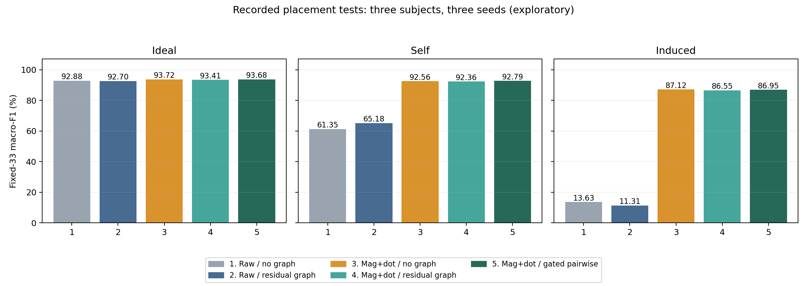
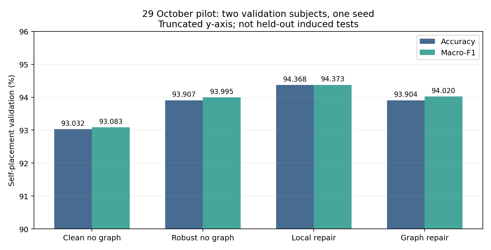

# Research progress and next decision for the professor

Reviewed 12 November 2026. Evidence comes from saved runs, not new training. Main conclusion: invariant features deliver the large placement-robustness gain; graph-specific superiority on induced placement remains unproven. A small self-placement graph advantage exists for gated pairwise, but it is exploratory and does not generalize to induced placement.

## 1. What has been done, in order

1. **DONE - implementation/training:** initial O1 and O2 studies on the earlier modified backbone, with completion manifests of 118 and 128 jobs. Preserve these as historical evidence; do not mix their metrics with the restored-summer comparison below.
2. **DONE - research/implementation:** restored the summer GIN aggregation/attention pipeline and checked source parity; separated graph, feature and reconstruction effects. The block named Mamba remains a gated temporal convolution/projection, not a selective SSM.
3. **DONE - implementation/training:** 126 restored O1 jobs (14 conditions x 3 subjects x 3 seeds, 31 epochs): static/physical/global/dynamic/residual/no graph, balanced residual, rotation, sensor dropout, GAE and DynamicWHAR comparator. Preserved checkpoint/epoch/prediction evidence; repaired an analysis-stage failure without retraining.
4. **DONE - research/verification:** dataset exclusion and split audits, raw-before-normalization augmentation, sensor ordering, proper rotations, magnitude/dot feature invariance and matched architecture bridge checks. The main retained cache has 76,268 windows; three all-zero recordings are excluded by the established audit.
5. **DONE - research/diagnostics:** diagnosed nearly constant dynamic affinity; used uniform/shuffled/donor interventions and forced graph changes to distinguish a connected message path from useful sample-dependent routing.
6. **DONE - implementation/training:** query/key zero-weight-decay repair at 8 and 31 epochs. It preserved parameter norms but did not restore useful routing or improve the matched source results. Not promoted.
7. **DONE - implementation/training:** 63 restored O2 jobs (7 conditions x 9 runs): magnitude and mag+dot with physical/residual/no graph plus raw rotation-augmented no graph. Mag+dot was selected through source validation; held-out placement results showed the large representation benefit.
8. **DONE - implementation/training:** 81 graph-alternative jobs (9 arms x 9 runs): sender masking, balanced mixing, dynamic-floor constraints, pairwise affinity, gated masked and gated pairwise alternatives. Gated pairwise slightly improved self placement; induced no graph remained ahead.
9. **DONE - implementation/training:** laptop Prabhat GPU environment, CPU-staged batches, visible single-terminal launcher, smoke, durable checkpoints and recovery. The 27 October six-job latent-message pilot compared no graph, local capacity and graph correction over two validation folds.
10. **DONE - research/implementation/training:** 28 October low-gate, open-gate and original-correction controlled studies: 36 full jobs plus 9 smoke jobs, 16 full epochs, two folds and two seeds. Added donor diagnostics. None passed the frozen promotion criteria against both no graph and local capacity. T08 closed as REVIEW_COMPLETE_NO_PROMOTION.
11. **DONE - implementation/training:** 29 October reliability-aware receiver-conditioned graph repair, EMA clean teacher, synthetic gain/drift augmentation, latent repair, quality prediction, null neighbor and signed messages. Four smoke jobs and eight full jobs (four arms x two folds x one seed, 16 epochs). The complete queue finished **29 October at 08:25:19 IST**. Source-validation accuracy results are below.
12. **DONE - supporting work:** genuine selective-Mamba specification exists; O3 federation preparation, smoke and centralized bridge exist. **NOT DONE:** genuine selective-Mamba implementation/validation, full final O3 comparison, confirmed induced graph superiority, placement detector or learned expert router.
13. **DONE - this review:** verified 270 historical job histories and recomputed **810 prediction-file metrics** for the restored O1/O2/alternative matrices. Re-audited the eight-job repair result, checkpoint state, unchanged source/data hashes, matched row identities and robust-arm RNG streams. Exported professor-facing plots, complete tables and an oracle complementarity analysis. Created the Astra/implementation file exchange and future plan. No Git action or new model training.

Counts of stored job records across suites are not all unique scientific conditions: bridge/control runs can reproduce earlier settings. Do not sum every suite into a claim of independent experiments.

## 2. Raw axes versus mag+dot: what wins?

Raw input means the six acceleration/gyroscope axes per IMU. Mag+dot has five features: ||A||, ||W||, A dot W, A(t) dot A(t-1), W(t) dot W(t-1). The first lag uses the first vector itself. No graph removes explicit neighbor aggregation but retains cross-sensor mixing in the later flattened temporal/head layers.

These are **fixed-33 macro-F1 percentages**, seed-averaged within each of test subjects 2,5,15, then averaged equally across subjects. Checkpoints were selected using separate source ideal validation. Subjects have been inspected repeatedly, so these are exploratory recorded-placement results. Small differences are not statistically established superiority.

| Input and model | Ideal F1 | Self F1 | Induced F1 |
|---|---:|---:|---:|
| Raw - no graph | 92.88 | 61.35 | 13.63 |
| Raw - physical graph | 92.12 | 63.83 | 10.79 |
| Raw - residual graph | 92.70 | 65.18 | 11.31 |
| Raw - dynamic graph | 93.10 | 65.27 | 11.10 |
| Raw - global graph | 93.14 | 64.87 | 10.96 |
| Mag+dot - no graph | **93.72** | 92.56 | **87.12** |
| Mag+dot - physical graph | 92.88 | 92.23 | 85.99 |
| Mag+dot - residual graph | 93.41 | 92.36 | 86.55 |
| Mag+dot - gated pairwise | 93.68 | **92.79** | 86.95 |

Interpretation:
- For raw, ordinary graphs help self placement; induced no graph wins over these graphs, although all raw unaugmented induced scores are poor. Raw residual versus no graph is +3.82 pp self F1 and -2.32 pp induced F1.
- With mag+dot, the original physical/residual graphs lose to no graph on self and induced. The later gated pairwise graph gains only +0.232 pp self F1 and trails by -0.169 pp induced F1. Do not claim that every graph loses self placement.
- The best raw self score in the wider comparator suite is DynamicWHAR, 77.47 F1 (82.30 accuracy), but it changes architecture. Raw residual+GAE reaches 68.33 self F1. These do not isolate a topology-only effect.
- Rotation augmentation is a separate recipe: raw augmented no graph reaches 74.78 induced F1, versus 66.55 for rotation-augmented residual. Neither beats mag+dot no graph's 87.12. Do not mix augmented and unaugmented rows in a causal graph comparison.
- The premise 'raw is better for ideal' is not supported by overall means: mag+dot no graph has 93.72 ideal F1 versus raw no graph 92.88 and raw global graph 93.14. It also has higher ideal accuracy (98.21 versus raw no graph 97.62).

| Selected model | Ideal accuracy | Self accuracy | Induced accuracy |
|---|---:|---:|---:|
| Raw - no graph | 97.62 | 64.40 | 13.32 |
| Raw - residual graph | 97.32 | 70.09 | 11.44 |
| Mag+dot - no graph | **98.21** | 96.84 | **87.42** |
| Mag+dot - residual graph | 97.83 | 96.48 | 86.66 |
| Mag+dot - gated pairwise | 98.11 | **97.04** | 87.01 |

Accuracy and fixed-33 macro-F1 differ because of class weighting and the fixed class set, including absent classes in individual scenario/subject subsets. Never call the F1 table 'accuracy'. Full values, subject spread and all conditions are in scenario_comparison.csv and all_job_metrics.csv.

## 3. What the latest repair run established

This is **source validation** on subjects 3 and 8, seed 13, not the above test subjects and not induced testing. Best checkpoints used ideal-validation F1 only.

| Arm | Ideal accuracy | Self accuracy | Self macro-F1 |
|---|---:|---:|---:|
| Clean no graph | 94.754 | 93.032 | 93.083 |
| Robust no graph | 95.114 | 93.907 | 93.995 |
| Local repair | **95.421** | **94.368** | **94.373** |
| Graph repair | 95.114 | 93.904 | 94.020 |

Graph gains +0.873 pp self accuracy over the clean baseline, but -0.003 pp versus equally augmented no graph and -0.463 pp versus local repair. Self F1 is +0.025 pp over robust no graph and -0.353 pp below local repair. Conclusion: **NO PROMOTION of graph superiority**; the clean-baseline gain is largely accounted for by the robust recipe. A 4-5 pp gain has not been achieved. The newest repair model has no induced-test score.

Representative graph samples have correction RMS only about 1.3-2.1% of local RMS and predicted quality near 0.96. These first-16-window diagnostics suggest a small correction and mostly high reliability on those samples; they do not establish calibrated misplacement detection or a global causal explanation. The shuffled-message intervention also changes only sender values while keeping receiver/routing context, so it is a limited intervention.

## 4. Main unresolved issues

1. Learned graphs have not added a consistent induced-placement advantage over a strong invariant no-graph baseline. Additional local capacity often matches or exceeds the graph gains.
2. Rotation-stable features address much of the raw-axis shift. Translation/attachment changes, severe multi-sensor displacement and difficult recordings remain; subject15 mutual7 should be investigated without removing it for poor performance.
3. The latest repair trained gain/drift proxies on 1-3 sensors. REALDISP mutual displacement involves 4-7 sensors, so its severity and corruption family are not a validated match. Unknown sensor units prevent claiming a physically exact lever-arm simulation.
4. Query/key collapse was real in earlier studies, but preventing norm collapse alone did not make messages useful. More edge variation is not itself a success metric.
5. Historical test subjects have influenced development. Future tuning needs explicit development/confirmation separation; new 'held-out' checkpoints must exclude test subjects during training, too.
6. Per-sensor displacement labels are not established by the inspected manual/cache. Recording-level scenario/count does not specify every wrong sensor. Self placement can be close to ideal; it is not automatically an error.
7. Genuine Mamba and full federation remain separate pending research work.

## 5. Are placement-specific experts worthwhile?

A soft raw/invariant mixture is technically reasonable, but not yet the highest-value large experiment. Before training a router, we aligned all historical raw-no-graph and mag+dot-no-graph prediction rows and computed a label-assisted selection upper bound:

| Scenario | Mag+dot accuracy | Perfect expert selector upper bound | Maximum recovered accuracy |
|---|---:|---:|---:|
| Ideal | 98.207 | 99.177 | +0.970 pp |
| Self | 96.837 | 98.220 | +1.383 pp |
| Induced | 87.424 | 87.821 | **+0.397 pp** |

The upper bound uses the true answer to choose an already correct expert. It is not a deployable model, not a macro-F1 bound, and not a bound on newly trained/fused experts. It shows that merely switching these existing experts cannot deliver +4-5 pp induced accuracy. Training a better displaced-data expert may create new complementarity, but changes data exposure and must be compared fairly.

Recommendation: build placement diagnostics first; retain mag+dot as the recognition anchor; introduce the raw branch only if a development study demonstrates complementary information worth its cost. Route from observed features/confidence, never true scenario labels. Keep ideal-only generalization and supervised placement-aware training as separate protocols.

## 6. Is anomaly-based placement warning feasible?

Yes, as a research direction with three distinct targets: detect inconsistency, identify the affected sensor, and estimate its actual location. Start with the first. The latter two require sensor-specific annotations or controlled new data. A constant sensor rotation leaves the implemented mag+dot features unchanged, so an orientation detector needs raw-sensitive information as well.

A useful graph-specific hypothesis is masked cross-sensor prediction: predict one sensor from others, detect abnormal standardized residuals, and use calibrated reliability to control messages or expert routing. Compare against local temporal prediction and a no-graph multichannel detector. Handle activity/user variation and cases where most sensors are disturbed. False alarms, detection delay and sensor localization must be evaluated separately from activity accuracy.

Full equations, labels, leakage controls, acceptance gates and an ordered effort plan are in `docs/experiments/placement_diagnostics_plan_20261112.md`. None of this future detector/router work has been trained by this review.

## 7. Astra <-> implementation communication

Use `docs/agent_exchange/current.json` as the pointer, with `docs/agent_exchange/protocol.md` as the contract. Astra owns frozen research specifications and acceptance decisions. Luna/Terra acknowledges exact revision/hash, implements, runs smoke, launches only the authorized full queue, and returns actual audit/metric evidence. Scientific ambiguity goes back as NEEDS_RESEARCH_DECISION. Each new session reads files; closed sessions do not communicate automatically. User synchronizes machines manually.

## Evidence and external context

- Main matrices: results/summer_o1_session_20261017_232945/training; results/summer_o2_session_20261021_173341/training; results/summer_o1_alternatives_session_20261022_001702/training.
- Repair: results/o1_graph_repair_20261029/full/{status.json,summary.json,audit.json,reproducibility_audit.json,paired_comparisons.csv,graph_diagnostics.csv}.
- Earlier source reviews: results/summer_o2_affinity_repair_31e_20261021/REPAIR_REPORT.md; results/local_message_pilot_20261027/PILOT_REVIEW.md; results/o1_t01_t08_20261028/T08_FINAL_REVIEW.md.
- Reproduce this review's historical tables/plots: `Prabhat\Scripts\python.exe results/research_review_20261112/build_review.py`; supplemental repair audit: `Prabhat\Scripts\python.exe review_graph_repair.py --output results/o1_graph_repair_20261029/full` (CPU postprocessing, no training).
- Dataset definitions: [UCI REALDISP](https://archive.ics.uci.edu/dataset/305/realdisp+activity+recognition+dataset) and local har_data/REALDISP/dataset manual.pdf. Placement/fusion prior art: [Banos et al., 2014](https://pubmed.ncbi.nlm.nih.gov/24915181/). File-based Codex context mechanism: [OpenAI AGENTS.md guidance](https://learn.chatgpt.com/docs/agent-configuration/agents-md). The proposed detector is a hypothesis, not a novelty claim.
